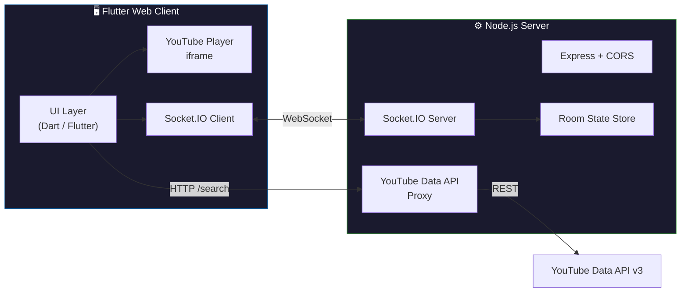

<div align="center">

# 🎵 SyncMusic

### Real-Time Synchronized Music Streaming

[](https://syncmusicstream.netlify.app/)
[](https://flutter.dev)
[](https://nodejs.org)
[](https://socket.io)
[](#-license)

**Create a room. Share the link. Listen together — in perfect sync.**

A collaborative music streaming app where multiple users join a shared room and listen to the same YouTube track, with play, pause, and seek synchronized in real time across every connected device.

[Try It Live →](https://syncmusicstream.netlify.app/) · [Report Bug](https://github.com/Einsteinium01/Real-Time_SynchronizedMusicStreamingWebApplication/issues) · [Request Feature](https://github.com/Einsteinium01/Real-Time_SynchronizedMusicStreamingWebApplication/issues)

</div>

---

<br>


<br>

## ⚡ Quick Start

> **No sign-up required. Three steps. Zero friction.**

| Step | Action |
|:----:|--------|
| **1** | Open **[syncmusicstream.netlify.app](https://syncmusicstream.netlify.app/)** — a new room is created automatically |
| **2** | **Copy the URL** and share it with friends — everyone in the same room is synced |
| **3** | **Search & play** any YouTube track — it starts on every device simultaneously |

---

## ✨ Features

| | Feature | Description |
|:-:|---------|-------------|
| 🎧 | **Instant Rooms** | Auto-generated room codes — no login, no setup |
| ▶️ | **Synced Playback** | Real-time play, pause & seek across all participants |
| 🔍 | **YouTube Search** | Search and play any YouTube video directly in-app |
| 🔗 | **Shareable Links** | One URL to invite anyone into your room |
| 🌐 | **Cross-Platform** | Runs in any modern browser (desktop & mobile) |
| ⚡ | **Low Latency** | Sub-second sync via persistent WebSocket connections |

---

## 🏗️ Architecture



### How Sync Works

1. A user **creates or joins** a room via a unique URL  
2. The server maintains room state: **Video ID**, **Timestamp**, **Play/Pause status**  
3. Any action (play, pause, seek, video change) is **broadcast** to all room members via Socket.IO  
4. Clients reconcile their player position — if drift exceeds **1 second**, an automatic seek correction fires  
5. A heartbeat timer sends timestamp updates every **3 seconds** to keep everyone locked in  

---

## 🛠️ Tech Stack

<table>
<tr>
<td align="center" width="50%">

### Frontend

| Technology | Purpose |
|:----------:|---------|
|  **Flutter Web** | Cross-platform UI framework |
|  **Dart** | Application logic |
| **youtube_player_iframe** | Embedded YouTube player |
| **socket_io_client** | Real-time WebSocket client |

</td>
<td align="center" width="50%">

### Backend

| Technology | Purpose |
|:----------:|---------|
|  **Node.js** | Server runtime |
|  **Express.js** | HTTP server & routing |
| **Socket.IO** | Real-time bidirectional events |
| **Axios** | YouTube API requests |

</td>
</tr>
</table>

### Deployment

| Service | Role |
|:-------:|------|
| [](https://syncmusicstream.netlify.app/) | Static hosting for Flutter Web build |
| [](https://render.com) | Node.js server with WebSocket support |

---

## 📂 Project Structure

```
Real-Time_SynchronizedMusicStreamingWebApplication/
├── lib/
│   └── main.dart              # Flutter app — UI, Socket.IO client, YouTube player
├── assets/
│   └── bg.jpg                 # Background image asset
├── web/
│   ├── index.html             # Web entry point
│   └── manifest.json          # PWA manifest
├── server.js                  # Node.js backend — rooms, sync, YouTube search proxy
├── package.json               # Node.js dependencies
├── pubspec.yaml               # Flutter dependencies
└── README.md
```

---

## 🚀 Getting Started

### Prerequisites

| Tool | Version | Install |
|------|---------|---------|
| Flutter SDK | ≥ 3.0 | [flutter.dev/docs/get-started](https://docs.flutter.dev/get-started/install) |
| Node.js | ≥ 18 | [nodejs.org](https://nodejs.org) |
| YouTube Data API Key | v3 | [Google Cloud Console](https://console.cloud.google.com/apis/credentials) |

### 1 · Clone the Repository

```bash
git clone https://github.com/Einsteinium01/Real-Time_SynchronizedMusicStreamingWebApplication.git
cd Real-Time_SynchronizedMusicStreamingWebApplication
```

### 2 · Start the Backend

```bash
# Install dependencies
npm install

# Set your YouTube API key
#   Linux / macOS:
export YT_API_KEY="your_youtube_api_key"
#   Windows (PowerShell):
$env:YT_API_KEY="your_youtube_api_key"

# Start the server
node server.js
# → Server running on port 3000
```

### 3 · Run the Frontend

```bash
# Install Flutter dependencies
flutter pub get

# Launch in Chrome
flutter run -d chrome
```

### 4 · Build for Production

```bash
flutter build web
# Output: build/web/ — deploy to any static host
```

> [!TIP]
> For local development, update the backend URL in [`lib/main.dart`](lib/main.dart) from `https://ghochu.onrender.com` to `http://localhost:3000`.

---

## 🗺️ Roadmap

- [ ] 🔐 User authentication & display names
- [ ] 📃 Playlist & queue management
- [ ] 💬 In-room chat system
- [ ] 🔊 Volume synchronization
- [ ] 👑 Admin / host controls
- [ ] 📜 Recently played & room history
- [ ] 🧠 Improved sync algorithm (NTP-style offset)
- [ ] 📱 Progressive Web App (PWA) support

---

## 🤝 Contributing

Contributions are welcome! Here's how:

1. **Fork** the repository  
2. **Create** a feature branch — `git checkout -b feat/amazing-feature`  
3. **Commit** your changes — `git commit -m "feat: add amazing feature"`  
4. **Push** to your branch — `git push origin feat/amazing-feature`  
5. **Open** a Pull Request  

---

## 👨‍💻 Author

<a href="https://github.com/Einsteinium01">
  
</a>

---

## 📄 License

This project is intended for **educational and learning purposes**.

---

<div align="center">

**If you found this useful, consider giving it a ⭐**

</div>
